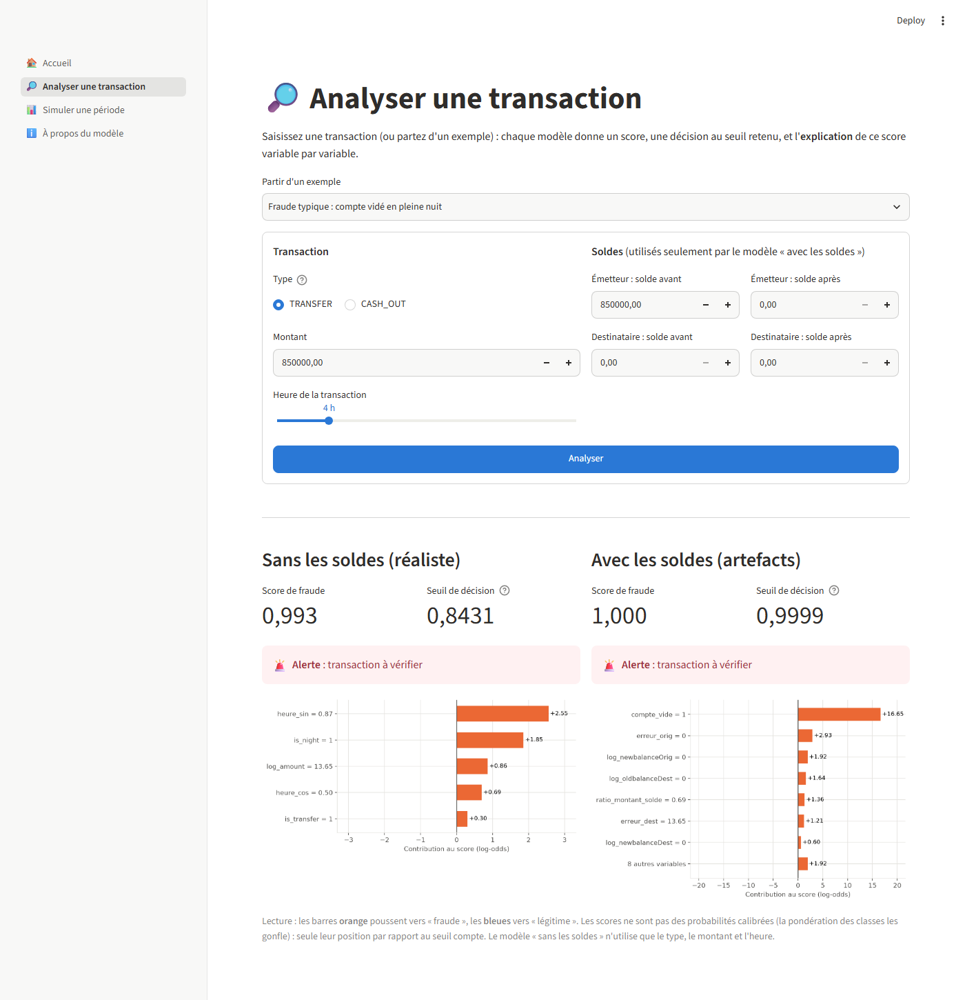
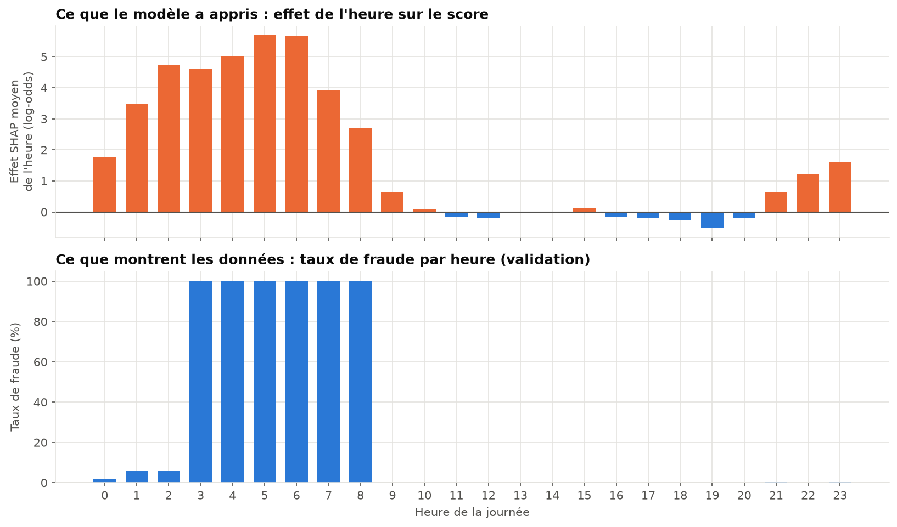
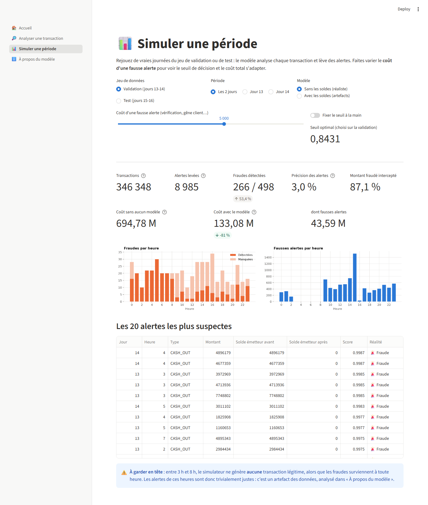

# Détection de fraude dans les transactions Mobile Money

> Projet de Machine Learning de bout en bout, de l'analyse exploratoire à une démo interactive. Il allie une démarche **académique** (hypothèses, tests statistiques, protocole temporel, intervalles de confiance) et une démarche **professionnelle** (code modulaire testé, pipeline reproductible, démo Streamlit).

     



## En bref

- **Problème** : détecter les transactions frauduleuses parmi 6,3 millions de transactions Mobile Money simulées (**0,13 %** de fraudes), en minimisant le coût total (fraudes ratées + fausses alertes).
- **Résultat** : sur des jours jamais vus, le modèle retenu intercepte **88 % du montant fraudé** et réduit le coût de **968 M à 141 M**. La règle métier existante, elle, laisse passer 99,8 % des fraudes.
- **Point fort de la démarche** : un score parfait (PR-AUC = 1,000) a été obtenu, puis **démonté**. Tests statistiques, étude de robustesse et explicabilité SHAP montrent qu'il vient d'**artefacts du simulateur**. La performance réaliste est estimée à une PR-AUC d'environ 0,2.

📄 **Rapport complet** : [reports/rapport_final.md](reports/rapport_final.md)

## Résultats

Évaluation finale sur le **jeu de test** (jours 15-16), utilisé une seule fois, avec un seuil choisi sur la validation en minimisant le coût métier :

| Modèle | PR-AUC | Fraudes détectées | Montant intercepté | Coût total |
|---|---|---|---|---|
| Sans modèle | — | 0 % | 0 % | 968 M |
| Règle métier existante (`isFlaggedFraud`) | 0,003 | 0,2 % | 0,5 % | 963 M |
| Règle « compte vidé » (issue de l'EDA) | 0,972 | 97,2 % | 84,5 % | 150 M |
| Régression logistique (sans soldes) | 0,110 | 50,0 % | 75,2 % | 349 M |
| **LightGBM sans soldes** | **0,417** | 54,0 % | **88,2 %** | **141 M** |
| LightGBM avec soldes | 1,000 | 99,8 % | 100 % | 0 |

### Ce qu'il faut retenir

1. **Le modèle « avec soldes » est parfait… à cause du simulateur.** Dans PaySim, 97,6 % des fraudes vident le compte émetteur, et les soldes des transactions légitimes sont souvent faux alors que ceux des fraudes sont exacts. Une règle d'une ligne atteint déjà une PR-AUC de 0,97.
2. **SHAP a révélé un artefact caché.** Le simulateur génère des fraudes à toute heure, mais **aucune** transaction légitime entre 3 h et 8 h. 27 % des fraudes sont donc détectables à la seule heure. Hors de ces heures, la PR-AUC du modèle sans soldes tombe à **0,18-0,23** : c'est l'estimation réaliste, portée par le montant et le type de transaction.
3. **Le seuil compte autant que le modèle.** Le choisir par le coût métier plutôt qu'à 0,5 divise le coût par deux. Ce choix reste stable quand le coût d'une fausse alerte varie d'un facteur 10.
4. **Les variables comptent plus que l'algorithme** : retirer les soldes coûte 0,6 de PR-AUC, régler les hyperparamètres ne rapporte que 0,008.

<p align="center">
  
</p>

## Démarche

| Étape | Contenu | Notebook / code |
|---|---|---|
| Cadrage | Problématique, 6 hypothèses, métriques, fonction de coût | [01_cadrage.md](reports/01_cadrage.md) |
| Qualité des données | Schéma, valeurs manquantes, cohérence des soldes, 8 particularités | [01](notebooks/01_chargement_qualite.ipynb) |
| EDA et tests | χ², Mann-Whitney, tailles d'effet, correction de Bonferroni | [02](notebooks/02_eda_hypotheses.ipynb) |
| Protocole | Découpage **temporel** train / validation / test / drift face à la non-stationnarité | [03](notebooks/03_protocole_experimental.ipynb) |
| Variables | 15 variables dans un pipeline scikit-learn sans état, stabilité (PSI) | [04](notebooks/04_feature_engineering.ipynb) |
| Références | Règles métier et régression logistique | [05](notebooks/05_baselines.ipynb) |
| Modélisation | Random Forest, XGBoost, LightGBM × 4 stratégies de déséquilibre, validation croisée temporelle, bootstrap | [06](notebooks/06_modelisation_avancee.ipynb) |
| Évaluation finale | Seuil optimal par le coût, sensibilité, test unique, hypothèse H6, robustesse au drift | [07](notebooks/07_evaluation_finale.ipynb) |
| Explicabilité | SHAP : importance, effets, explications individuelles, artefacts | [08](notebooks/08_explicabilite.ipynb) |
| Industrialisation | Pipeline d'entraînement en une commande, métadonnées JSON | [src/train.py](src/train.py) |
| Démo | Application Streamlit à 3 pages | [app/](app/streamlit_app.py) |

## Compétences mises en œuvre

- **Statistiques** : tests non paramétriques, tailles d'effet, corrections pour tests multiples, bootstrap apparié.
- **Machine Learning** : déséquilibre extrême (pondération, sous-échantillonnage, SMOTE), boosting, validation croisée temporelle, recherche d'hyperparamètres, choix du seuil par le coût.
- **Rigueur expérimentale** : jeu de test isolé et utilisé une seule fois, détection de fuites et d'artefacts, étude de robustesse, diagnostic d'un échec d'optimisation.
- **Explicabilité** : SHAP (global, local, dépendances), interprétation critique des résultats.
- **Génie logiciel** : bibliothèque `src/` modulaire, 88 tests `pytest`, pipeline scikit-learn / imblearn réutilisé de l'entraînement à la démo, CLI, versionnage Git par étapes.
- **Communication** : notebooks commentés, rapport académique, démo interactive, visualisations accessibles (palette adaptée au daltonisme).

## Démo

<p align="center">
  
</p>

Trois pages :
- **Analyser une transaction** : score de fraude des deux modèles, décision au seuil retenu, explication SHAP ;
- **Simuler une période** : rejouer une journée réelle et voir l'effet du coût d'une fausse alerte sur les alertes et le coût total ;
- **À propos du modèle** : performances, ce que le modèle a appris, limites liées au simulateur.

## Installation et utilisation

### 1. Installer

```bash
git clone https://github.com/cheikhahmedtidiane/projet_detection_fraude.git
cd projet_detection_fraude
python -m venv .venv
.venv\Scripts\activate        # Windows  (Linux/Mac : source .venv/bin/activate)
pip install -r requirements.txt
```

### 2. Récupérer les données

Les données ne sont pas versionnées (≈ 470 Mo). Téléchargez le CSV depuis [Kaggle](https://www.kaggle.com/datasets/sriharshaeedala/financial-fraud-detection-dataset) et placez-le ici :

```
data/raw/Synthetic_Financial_datasets_log.csv
```

Exécutez ensuite le notebook [03_protocole_experimental.ipynb](notebooks/03_protocole_experimental.ipynb) : il crée le cache Parquet et les jeux découpés utilisés par la démo.

### 3. Entraîner les modèles (~30 secondes)

```bash
python -m src.train
```

Options : `--models lightgbm_transaction` (un seul modèle), `--cost-fp 2000` (autre coût de fausse alerte pour le seuil). Chaque modèle est sauvegardé dans `models/` avec ses métadonnées JSON (réglages, seuil, métriques de validation, versions).

### 4. Lancer la démo

```bash
streamlit run app/streamlit_app.py
```

La démo s'ouvre à l'adresse http://localhost:8501.

### 5. Lancer les tests

```bash
pytest
```

> **Environnement virtuel** : les commandes ci-dessus supposent que `.venv` est **activé** (l'invite commence par `(.venv)`). Sinon, le terminal répond par exemple *« Le terme "streamlit" n'est pas reconnu »*. Deux solutions :
> - activer l'environnement dans chaque nouveau terminal : `.venv\Scripts\activate` ;
> - ou appeler directement son Python : `.venv\Scripts\python -m src.train`, `.venv\Scripts\python -m streamlit run app/streamlit_app.py`, `.venv\Scripts\python -m pytest` (Linux/Mac : `.venv/bin/python …`).
>
> Sous PowerShell, si l'activation est refusée (« l'exécution de scripts est désactivée ») : `Set-ExecutionPolicy -Scope CurrentUser RemoteSigned`.

## Structure du projet

```
projet_detection_fraude/
├── app/                    # Démo Streamlit (point d'entrée + 4 pages)
├── data/                   # Données brutes et transformées (non versionnées)
├── models/                 # Modèles entraînés + métadonnées (non versionnés)
├── notebooks/              # 8 notebooks d'analyse, numérotés et exécutés
├── reports/
│   ├── 01_cadrage.md       # Cadrage et hypothèses
│   ├── rapport_final.md    # Rapport académique
│   ├── figures/            # Graphiques
│   └── results/            # Tableaux de résultats (CSV)
├── src/                    # Bibliothèque du projet
│   ├── config.py           #   chemins, constantes, bornes du découpage, coût
│   ├── data.py             #   chargement, schéma, contrôles qualité
│   ├── stats.py            #   tests statistiques et tailles d'effet
│   ├── split.py            #   découpage temporel
│   ├── features.py         #   feature engineering (pipeline scikit-learn)
│   ├── baselines.py        #   règles métier et régression logistique
│   ├── models.py           #   Random Forest, XGBoost, LightGBM, déséquilibre
│   ├── evaluate.py         #   métriques, coût métier, seuil optimal, bootstrap
│   ├── explain.py          #   SHAP
│   ├── viz.py              #   style graphique commun
│   └── train.py            #   pipeline d'entraînement (CLI)
├── tests/                  # 88 tests unitaires et de bout en bout
├── requirements.txt
└── pyproject.toml
```

## Limites

Les données proviennent d'un **simulateur**. Les performances du modèle « avec soldes » ne se transposeraient pas à des données réelles, et celles du modèle « sans soldes » sont en partie gonflées par l'artefact horaire. La **démarche** (protocole temporel, seuil par le coût, détection d'artefacts par l'explicabilité) est, elle, directement réutilisable. Voir la section 7 du [rapport](reports/rapport_final.md).

## Auteur

**Cheikh Ahmed Tidiane** — [GitHub](https://github.com/cheikhahmedtidiane)
