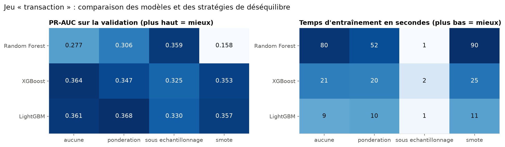
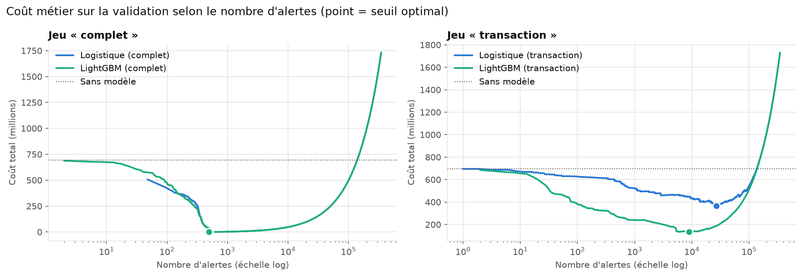
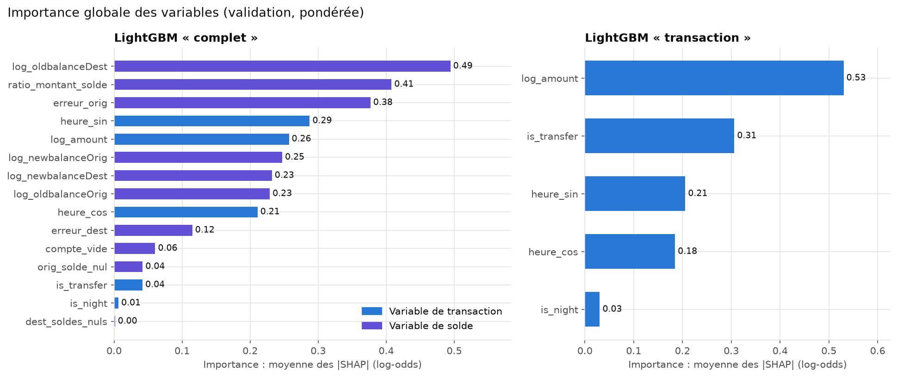
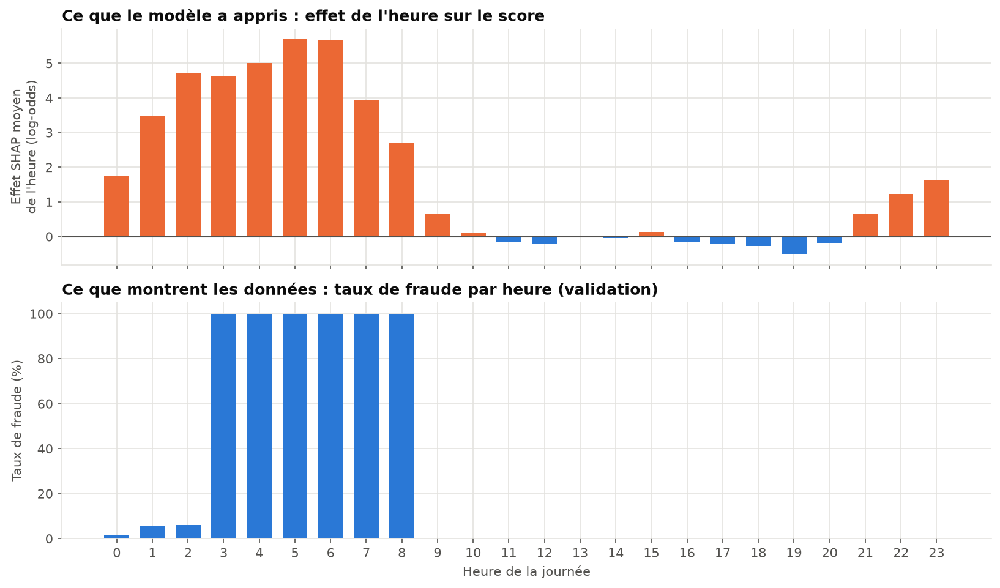

# Détection de fraude dans les transactions Mobile Money

## Rapport final

**Auteur** : Cheikh Ahmed Tidiane
**Données** : *Financial Fraud Detection Dataset* (Kaggle), simulateur PaySim
**Code** : [github.com/cheikhahmedtidiane/projet_detection_fraude](https://github.com/cheikhahmedtidiane/projet_detection_fraude)

---

## Résumé

Ce projet étudie la détection automatique de transactions frauduleuses dans un service de Mobile Money, à partir de 6,36 millions de transactions simulées (0,13 % de fraudes). La démarche combine une approche **académique** et une approche **professionnelle** :
- côté académique : hypothèses formulées a priori, tests statistiques avec tailles d'effet, protocole d'évaluation temporel, intervalles de confiance bootstrap ;
- côté professionnel : code modulaire testé (88 tests), pipeline d'entraînement reproductible, démo interactive.

Le meilleur modèle, un LightGBM pondéré utilisant toutes les variables, détecte **569 fraudes sur 570** du jeu de test sans aucune fausse alerte. Ce score quasi parfait ne doit **pas** être pris pour une performance réaliste. Les tests statistiques, une étude de robustesse et l'explicabilité SHAP montrent qu'il repose presque entièrement sur des **artefacts du simulateur** :
- les fraudes vident le compte émetteur ;
- leurs soldes sont cohérents alors que ceux des transactions légitimes ne le sont pas ;
- aucune transaction légitime n'a lieu entre 3 h et 8 h.

Sans les variables de soldes, un LightGBM réglé obtient une PR-AUC de **0,417** sur le test et intercepte **88 % du montant fraudé**, au seuil qui minimise le coût métier. L'explicabilité montre toutefois que la moitié de cette performance vient elle aussi de l'artefact horaire. Une fois les heures sans activité légitime exclues, la PR-AUC réaliste se situe entre **0,18 et 0,23**, soit encore 170 à 190 fois mieux que le hasard. Elle repose sur le montant et le type de transaction.

Le principal apport du projet est donc méthodologique : une démarche rigoureuse ne se contente pas d'un bon score, elle établit **d'où il vient**.

---

## 1. Introduction

### 1.1 Contexte

Le Mobile Money est devenu un moyen de paiement central, en particulier en Afrique subsaharienne. Sa diffusion s'accompagne de fraudes : prise de contrôle de comptes, transferts suivis d'un retrait immédiat, ingénierie sociale. Un opérateur doit détecter ces transactions **rapidement**, tout en limitant les **fausses alertes**, qui mobilisent des analystes et dégradent l'expérience des clients légitimes.

### 1.2 Problématique

> Peut-on détecter automatiquement les transactions frauduleuses à partir des seules informations de la transaction, en minimisant le coût total supporté par l'opérateur (fraudes non détectées et fausses alertes) ?

Formellement, il s'agit d'une **classification binaire supervisée** sous **déséquilibre extrême** (1 fraude pour 775 transactions), avec une **décision à coût asymétrique**.

### 1.3 Contributions

1. Une analyse statistique des facteurs de fraude (6 hypothèses, tests non paramétriques, tailles d'effet, correction de Bonferroni).
2. Un protocole d'évaluation **temporel** adapté à la non-stationnarité des données, avec un jeu de test utilisé une seule fois et un jeu de « drift » pour la robustesse.
3. Une comparaison de trois familles de modèles et de quatre stratégies de gestion du déséquilibre, avec mesure du coût de calcul.
4. Un choix du seuil de décision par **minimisation du coût métier**, avec analyse de sensibilité.
5. Une **étude de robustesse** (avec et sans variables de soldes) et une **analyse d'explicabilité** (SHAP) qui quantifient la part de la performance due aux artefacts du simulateur.
6. Un code industrialisable : bibliothèque `src/`, tests, pipeline d'entraînement et démo Streamlit.

---

## 2. Données

### 2.1 Description

| Caractéristique | Valeur |
|---|---|
| Source | PaySim (Lopez-Rojas et al., 2016), via Kaggle |
| Volume | 6 362 620 transactions, 11 colonnes |
| Période | 743 heures de simulation (~31 jours) |
| Fraudes | 8 213 (0,129 %) |
| Types | `CASH_IN`, `CASH_OUT`, `DEBIT`, `PAYMENT`, `TRANSFER` |

Chaque transaction comporte :
- son moment (`step`, en heures), son type et son montant ;
- les identifiants de l'émetteur et du destinataire ;
- leurs soldes avant et après l'opération ;
- la cible `isFraud` et une règle métier existante, `isFlaggedFraud`.

### 2.2 Qualité et particularités (notebook 01)

Le jeu est techniquement propre : aucune valeur manquante, aucun doublon, aucun montant négatif. L'analyse révèle cependant des particularités déterminantes :
- la fraude n'existe que dans les types `TRANSFER` et `CASH_OUT` ;
- la règle `isFlaggedFraud` ne lève que **16 alertes** sur 6,3 millions de transactions (99,8 % des fraudes ratées) ;
- les soldes émetteurs sont fréquemment incohérents pour les transactions légitimes ;
- les montants frauduleux sont **plafonnés à 10 000 000** ;
- 97 % des `TRANSFER` vers des destinataires aux soldes nuls sont des fraudes ;
- les émetteurs sont quasi uniques, ce qui empêche de construire un historique par client.

Ces observations ont orienté la suite : filtrage sur les deux types concernés, choix des métriques, et vigilance face aux possibles **artefacts de simulation**.

---

## 3. Hypothèses

Les hypothèses ont été formulées **avant** l'analyse exploratoire (cadrage : [01_cadrage.md](01_cadrage.md)).

| # | Hypothèse |
|---|---|
| H1 | La fraude dépend du type de transaction. |
| H2 | Les montants frauduleux sont plus élevés que les montants légitimes. |
| H3 | Les fraudes tendent à vider le compte émetteur. |
| H4 | Les incohérences de soldes sont discriminantes. |
| H5 | Le taux de fraude varie selon l'heure : la fraude ne suit pas le cycle d'activité diurne des clients légitimes. |
| H6 | Un modèle de Machine Learning surpasse significativement la règle `isFlaggedFraud`. |
| RQ | Quelle stratégie de gestion du déséquilibre offre le meilleur compromis performance / coût de calcul ? |

---

## 4. Méthodologie

### 4.1 Tests statistiques (notebook 02)

Les variables continues sont très asymétriques : on utilise donc des tests **non paramétriques**.
- **Variables catégorielles** : χ² d'indépendance avec le V de Cramér.
- **Variables continues** : Mann-Whitney U avec la corrélation bisériale de rang.
- **Proportions** : odds ratios.

Avec plus de 2,7 millions d'observations, tout écart devient « significatif ». Les conclusions s'appuient donc sur les **tailles d'effet** plutôt que sur les p-valeurs. La multiplicité des tests est contrôlée par une correction de **Bonferroni** (6 tests, α ≈ 0,0083).

### 4.2 Protocole expérimental (notebook 03)

Le taux de fraude n'est **pas stationnaire**. On distingue deux régimes :
- un régime « normal » (jours 0-1 et 5-16, ~94 % du volume, ~0,14 % de fraudes) ;
- un régime « anormal » (jours 2-4 et 17-30), à faible volume mais où se concentrent 54 % des fraudes.

Quatre stratégies de découpage ont été comparées :

| Stratégie | Problème |
|---|---|
| Aléatoire stratifié | Fuite temporelle : le modèle apprend sur le futur. |
| Temporel 70/15/15 par volume | Test au taux de fraude 5 fois supérieur à l'entraînement. |
| Temporel par jours, naïf | Test au taux de fraude 17 fois supérieur à l'entraînement. |
| **Temporel, quatre jeux (retenu)** | Ordre respecté et test représentatif. |

| Jeu | Jours | Transactions | Fraudes | Rôle |
|---|---|---|---|---|
| Train | 0-12 | 1 917 584 | 3 511 (0,18 %) | apprentissage |
| Validation | 13-14 | 346 348 | 498 (0,14 %) | comparaison, réglage, choix du seuil |
| Test | 15-16 | 349 818 | 570 (0,16 %) | **évaluation finale unique** |
| Drift | 17-30 | 156 659 | 3 634 (2,32 %) | robustesse au changement de régime |

Les données sont restreintes aux types `TRANSFER` et `CASH_OUT`. L'absence de chevauchement temporel est vérifiée par un test automatique.

### 4.3 Variables (notebook 04)

Quinze variables sont construites par un transformateur scikit-learn **sans état**. Chaque variable ne dépend que de la transaction elle-même, ce qui exclut toute fuite de données. Elles forment deux jeux :
- **`transaction`** (5 variables) : type (`is_transfer`), montant (`log_amount`), heure en encodage cyclique (`heure_sin`, `heure_cos`) et indicateur de nuit (`is_night`) ;
- **`complet`** (15 variables) : les précédentes, plus les soldes en échelle logarithmique, les erreurs de solde (`erreur_orig`, `erreur_dest`), `compte_vide`, `orig_solde_nul`, `dest_soldes_nuls` et `ratio_montant_solde`.

Comparer ces deux jeux constitue l'**étude de robustesse** : elle mesure la part de la performance qui dépend des mécanismes de mise à jour des soldes propres au simulateur. La stabilité des variables est contrôlée par l'indice PSI. Toutes sont stables entre train, validation et test ; trois dérivent modérément sur le jeu de drift.

### 4.4 Modèles

**Références (notebook 05)** :
- le modèle naïf, qui ne signale jamais de fraude ;
- la règle `isFlaggedFraud` ;
- la règle « compte vidé », issue de H3 (montant = solde initial > 0) ;
- une régression logistique pondérée.

**Modèles avancés (notebook 06)** :
- Random Forest ;
- XGBoost (Chen & Guestrin, 2016) ;
- LightGBM (Ke et al., 2017).

**Stratégies de déséquilibre** (rééchantillonnage appliqué au seul train, dans un pipeline `imblearn`) :
- aucune ;
- pondération des classes (poids ≈ 545) ;
- sous-échantillonnage aléatoire (1 fraude pour 10 légitimes) ;
- SMOTE (Chawla et al., 2002).

**Réglage** : recherche aléatoire de 20 configurations (Bergstra & Bengio, 2012), évaluées par une **validation croisée temporelle** à fenêtre croissante sur le train (trois plis de deux jours).

### 4.5 Métriques et coût métier

- **Métrique principale** : la **PR-AUC** (précision moyenne). Elle reste informative sous fort déséquilibre, contrairement à l'exactitude et, dans une moindre mesure, à la ROC-AUC (Saito & Rehmsmeier, 2015).
- **Coût métier** :

$$\text{Coût} = \sum_{\text{fraudes non détectées}} \text{montant} \; + \; N_{\text{fausses alertes}} \times C_{FP}, \qquad C_{FP} = 5\,000$$

- **Seuil de décision** : celui qui minimise ce coût sur la **validation**. Il est ensuite appliqué tel quel au test.
- **Incertitude** : la significativité des écarts est évaluée par **bootstrap apparié** (300 rééchantillonnages).

### 4.6 Explicabilité (notebook 08)

Les valeurs de Shapley (SHAP, Lundberg & Lee, 2017) sont calculées exactement par `TreeExplainer`, sur la validation. On analyse :
- l'importance globale, pondérée pour refléter la population, ainsi que l'importance sur les seules fraudes ;
- le sens des effets ;
- les dépendances (heure, montant) ;
- des explications individuelles.

---

## 5. Résultats

### 5.1 Tests d'hypothèses (notebook 02)

| # | Test | Taille d'effet | Verdict |
|---|---|---|---|
| H1 | χ² type × fraude | V = 0,06 (fraude absente de 3 types sur 5) | validée |
| H2 | Mann-Whitney sur le montant | r = 0,37 (moyen) | validée |
| H3 | χ² compte vidé × fraude | V = 0,99 (quasi parfait) | validée |
| H4 | Mann-Whitney sur les erreurs de solde | r = −0,89 (émetteur), 0,50 (destinataire) | validée |
| H5 | χ² heure × fraude | V = 0,31 (moyen) ; 8,1 % de fraudes la nuit contre 0,2 % le jour | validée |

Toutes les hypothèses sont validées au seuil corrigé, avec des tailles d'effet très contrastées. L'effet quasi parfait de H3 a été immédiatement signalé comme un **artefact probable du simulateur**.

### 5.2 Modèles de référence (validation, notebook 05)

| Modèle | PR-AUC | Précision | Rappel | Montant détecté |
|---|---|---|---|---|
| Règle `isFlaggedFraud` | 0,001 | — (0 alerte) | 0 % | 0 % |
| Règle « compte vidé » | 0,992 | 100 % | 99,2 % | 94,2 % |
| Logistique (`transaction`) | 0,050 | 0,5 % | 69,5 % | 84,9 % |
| Logistique (`complet`) | 1,000 | 89,6 % | 100 % | 100 % |

Une règle d'une ligne atteint 99,2 % de rappel avec 100 % de précision. Elle ne rate que les fraudes plafonnées à 10 M, depuis des comptes plus riches, qui sont aussi les plus coûteuses. Sans les soldes, le problème devient réellement difficile.

### 5.3 Modèles avancés et déséquilibre (notebook 06)

**Jeu `transaction`, PR-AUC sur la validation** :

| | aucune | pondération | sous-échant. | SMOTE |
|---|---|---|---|---|
| Random Forest | 0,277 | 0,306 | **0,359** | 0,158 |
| XGBoost | **0,364** | 0,347 | 0,325 | 0,353 |
| LightGBM | 0,361 | **0,368** | 0,330 | 0,357 |

**Réponse à la question de recherche** :
- Les modèles à arbres sont **7 fois meilleurs** que la logistique (0,36 contre 0,05) : la relation entre montant, type et heure est non linéaire.
- Pour le **boosting**, la stratégie de déséquilibre importe peu (0,33-0,37).
- Pour la **Random Forest**, le sous-échantillonnage est décisif (0,28 → 0,36).
- **SMOTE** est inutile, voire nuisible : il interpole des variables binaires et cycliques et produit des valeurs impossibles.
- Le **sous-échantillonnage** offre le meilleur rapport performance / coût : il divise le temps d'entraînement par 10 à plus de 100 (≈ 1 s).

**Réglage** : la validation croisée temporelle retient un LightGBM simple (15 feuilles, 200 itérations). Le gain est statistiquement détectable mais minime : +0,008 de PR-AUC, IC 95 % [+0,002 ; +0,014]. La variabilité entre plis (~0,03) dépasse l'écart entre les meilleures configurations.

**Diagnostic** : avec ses réglages par défaut, LightGBM s'effondrait (PR-AUC 0,008). La cause était un **échec d'optimisation**, identifié parce que les scores étaient aussi mauvais sur le train que sur la validation :
- initialisation au log-odds de la prévalence brute malgré la pondération ;
- hessiennes quasi nulles sur des données presque séparables.

Ce problème a été corrigé (`boost_from_average=False`, `min_child_weight=1`).

**Jeu `complet`** : les trois modèles atteignent une PR-AUC de 1,000 et détectent les 498 fraudes. LightGBM ne produit qu'une seule fausse alerte au seuil de 0,5.

### 5.4 Seuil de décision et coût métier (notebook 07)

Pour LightGBM `transaction`, le seuil optimal (0,84) ramène les alertes de 47 140 à 8 985 et **divise le coût par deux** sur la validation (275 M → 133 M ; sans modèle : 695 M). Ce seuil accepte une précision de seulement 3 %. C'est rationnel : une fraude coûte en moyenne ~1,4 M, autant qu'environ 280 fausses alertes.

La décision est **robuste à l'hypothèse de coût** : quand $C_{FP}$ varie d'un facteur 10 (de 2 000 à 20 000), le montant intercepté reste entre 84 et 89 %.

### 5.5 Évaluation finale sur le test (notebook 07)

Les seuils ont été figés sur la validation et le test évalué **une seule fois**.

| Modèle | PR-AUC | Alertes | Fraudes détectées | Montant intercepté | Coût total |
|---|---|---|---|---|---|
| Sans modèle | — | 0 | 0 % | 0 % | 968 M |
| Règle `isFlaggedFraud` | 0,003 | 1 | 0,2 % | 0,5 % | 963 M |
| Règle « compte vidé » | 0,972 | 554 | 97,2 % | 84,5 % | 150 M |
| Logistique (`transaction`) | 0,110 | 22 073 | 50,0 % | 75,2 % | 349 M |
| **LightGBM (`transaction`)** | **0,417** | 5 582 | 54,0 % | **88,2 %** | **141 M** |
| **LightGBM (`complet`)** | **1,000** | 569 | 99,8 % | **100 %** | **0** |

- **Généralisation** : les performances sur le test sont égales ou supérieures à celles de la validation. On n'observe aucun sur-ajustement au jeu de validation.
- **H6 est validée** : tous les modèles appris surpassent la règle `isFlaggedFraud`. L'intervalle de confiance de l'écart de PR-AUC est entièrement positif, et le modèle fait mieux dans 100 % des rééchantillonnages. L'économie est de 822 M (LightGBM `transaction`) à 963 M (LightGBM `complet`) sur deux jours. La règle existante étant presque inopérante, la comparaison la plus exigeante est celle avec la règle « compte vidé », que LightGBM `complet` bat aussi (150 M → 0).

### 5.6 Robustesse temporelle (notebook 07)

Le jeu de drift (jours 17-30) relève du régime anormal, avec 14 fois plus de fraudes que le test. La PR-AUC dépend mécaniquement de la prévalence ; la robustesse est donc jugée sur la ROC-AUC, qui n'en dépend pas.

| Modèle | ROC-AUC test | ROC-AUC drift | Rappel au seuil (test → drift) |
|---|---|---|---|
| LightGBM (`complet`) | 1,000 | 1,000 | 99,8 % → 99,5 % |
| LightGBM (`transaction`) | 0,880 | 0,873 | 54 % → 55 % |
| Logistique (`transaction`) | 0,829 | 0,814 | 50 % → 51 % |

Les modèles sont **robustes** au changement de régime : la ROC-AUC journalière de LightGBM `transaction` reste comprise entre 0,82 et 0,90. Le dernier jour de la simulation ne contient que des fraudes (artefact) ; il a été exclu de l'analyse journalière.

### 5.7 Explicabilité (notebook 08)

**Modèle `complet`** : les variables de solde portent 73 % de l'importance. Sur les fraudes, `compte_vide` contribue en moyenne à **+17,9 log-odds**, loin devant `erreur_orig` (3,3). Le modèle a appris que :
- les fraudes ont des soldes émetteurs **exacts** ;
- leur destinataire **n'est pas crédité** ;
- leur solde destinataire est nul.

Il combine ces artefacts pour détecter les fraudes plafonnées à 10 M, que la règle « compte vidé » ratait.

**Modèle `transaction`** :
- **Type** : un `TRANSFER` ajoute +0,83 au score, un `CASH_OUT` −0,17.
- **Montant** : effet non linéaire, négatif entre 50 000 et 400 000, puis fortement positif au-delà de 500 000, avec un plateau au plafond de 10 M.
- **Heure** : c'est l'effet le plus fort sur les fraudes, de +3,5 à +5,7 log-odds entre 1 h et 7 h.

**Un artefact révélé par l'explicabilité** :
- Le simulateur génère environ 20 fraudes par heure, **à toute heure**.
- Les transactions légitimes suivent un cycle journalier et tombent à **zéro entre 3 h et 8 h**.
- Ainsi, **27 % des fraudes** surviennent à des heures sans aucune transaction légitime.
- Hors de ces heures, la PR-AUC de LightGBM `transaction` passe de 0,375 à **0,181** sur la validation, et de 0,417 à **0,228** sur le test.

---

## 6. Discussion

### 6.1 Un score parfait n'est pas une preuve de qualité

Le modèle `complet` est parfait sur le test et sur le drift. Pourtant, chaque étape de la démarche a montré que cette perfection est **construite par le simulateur**, et non apprise d'un comportement de fraudeur :
- l'EDA mesure un V de Cramér de 0,99 pour « compte vidé » ;
- une règle d'une ligne atteint une PR-AUC de 0,99 ;
- SHAP attribue +18 log-odds à cette seule variable.

Les incohérences de soldes vont même à l'**inverse** de ce qu'on attendrait dans la réalité : ce sont les transactions légitimes qui ont des soldes faux. Ce modèle ne serait pas transposable à des données réelles.

### 6.2 Ce qui est réel et ce qui est artefact

| Signal | Hypothèse | Nature |
|---|---|---|
| Compte vidé | H3 | artefact |
| Soldes émetteurs exacts / destinataire non crédité | H4 | artefact |
| Heures sans activité légitime | H5 | artefact (pas d'activité légitime la nuit, fraudes uniformes dans le temps) |
| Fraudes plafonnées à 10 M | H2 (en partie) | artefact |
| Montants élevés | H2 | **signal plausible** |
| Type `TRANSFER` | H1 | **signal plausible** |

H5 illustre la différence entre **valider** une hypothèse et l'**interpréter**. Le test du χ² la confirme, et l'effet va bien dans le sens formulé au cadrage : la fraude ne suit pas le cycle diurne. Mais la cause n'est pas une préférence des fraudeurs pour la nuit : le simulateur ne module tout simplement pas leur activité selon l'heure. Sur des données réelles, cet effet serait bien plus faible.

### 6.3 Estimation réaliste de la performance

La meilleure estimation d'une performance transposable est celle du modèle `transaction` hors heures vides : une **PR-AUC de 0,18 à 0,23**, pour une prévalence d'environ 0,11 %, soit 170 à 190 fois mieux que le hasard. Cet ordre de grandeur est cohérent avec ce que l'on observe en détection de fraude réelle, où les meilleurs systèmes combinent historique client, appareil et réseau de transactions (Bolton & Hand, 2002 ; Dal Pozzolo et al., 2015).

### 6.4 Enseignements méthodologiques

1. **Le protocole temporel est indispensable** : un découpage naïf aurait produit un test non représentatif, avec un taux de fraude jusqu'à 17 fois supérieur.
2. **Le choix des variables pèse plus que celui du modèle** : retirer les soldes coûte 0,6 de PR-AUC, passer des arbres à la logistique 0,3, et le réglage des hyperparamètres n'apporte que 0,008.
3. **Le seuil compte autant que le modèle** : le choisir par le coût divise ce coût par deux.
4. **Diagnostiquer plutôt que conclure** : comparer les scores sur le train et la validation a distingué un échec d'optimisation d'une limite du modèle.
5. **L'explicabilité est un outil de validation**, pas seulement de communication : elle a révélé un artefact que l'EDA n'avait pas identifié comme tel.

---

## 7. Limites et perspectives

### Limites
- **Données simulées** : les conclusions sur les modèles sont propres à PaySim. Seule la démarche est directement transposable.
- **Coût métier simplifié** : coût fixe par fausse alerte, sans capacité limitée d'analystes, sans gêne client différenciée ni récupération partielle des fonds.
- **Fenêtres d'évaluation courtes** : deux jours de validation et deux de test. Le bootstrap suppose l'indépendance des transactions et ignore la dépendance temporelle (un bootstrap par blocs serait plus adapté).
- **Probabilités non calibrées** : la pondération des classes déforme les probabilités. Seul l'ordre des scores et le seuil ont un sens.

### Perspectives
- Évaluer la démarche sur des **données réelles** ou sur un simulateur corrigé de ses artefacts.
- Retirer explicitement les signaux artificiels (heure brute, soldes) et construire des variables **comportementales** (historique du destinataire, vitesse des transactions, graphe émetteur-destinataire).
- **Calibrer** les probabilités (régression isotonique, Platt) pour un usage en scoring.
- Intégrer une **contrainte de capacité** (nombre maximal d'alertes traitables par jour) dans le choix du seuil.
- Surveiller la **dérive** en production et recalibrer le seuil quand la prévalence change.

---

## 8. Conclusion

Ce projet a mené une chaîne complète de Machine Learning, du cadrage à la démo, sur un problème de détection de fraude sous déséquilibre extrême. Les modèles finaux surpassent très largement la règle métier existante (H6 validée). Le modèle sans variables de soldes intercepte 88 % du montant fraudé sur des jours jamais vus.

Le résultat le plus important est cependant d'avoir **qualifié** ces performances. Le score parfait du modèle complet et une partie de celui du modèle réduit proviennent d'artefacts du simulateur, identifiés par trois approches indépendantes et convergentes : tests statistiques, étude de robustesse et explicabilité. La performance réaliste estimée (PR-AUC ≈ 0,2) est plus modeste, mais elle est **défendable**. C'est la différence entre un modèle qui obtient un bon score et un modèle dont on comprend pourquoi il l'obtient.

---

## Références

- Bergstra, J., & Bengio, Y. (2012). *Random Search for Hyper-Parameter Optimization*. Journal of Machine Learning Research, 13.
- Bolton, R. J., & Hand, D. J. (2002). *Statistical Fraud Detection: A Review*. Statistical Science, 17(3).
- Chawla, N. V., Bowyer, K. W., Hall, L. O., & Kegelmeyer, W. P. (2002). *SMOTE: Synthetic Minority Over-sampling Technique*. Journal of Artificial Intelligence Research, 16.
- Chen, T., & Guestrin, C. (2016). *XGBoost: A Scalable Tree Boosting System*. KDD.
- Cohen, J. (1988). *Statistical Power Analysis for the Behavioral Sciences* (2nd ed.). Lawrence Erlbaum.
- Dal Pozzolo, A., Caelen, O., Johnson, R. A., & Bontempi, G. (2015). *Calibrating Probability with Undersampling for Unbalanced Classification*. IEEE SSCI.
- Efron, B., & Tibshirani, R. J. (1993). *An Introduction to the Bootstrap*. Chapman & Hall.
- Ke, G. et al. (2017). *LightGBM: A Highly Efficient Gradient Boosting Decision Tree*. NeurIPS.
- Lopez-Rojas, E. A., Elmir, A., & Axelsson, S. (2016). *PaySim: A Financial Mobile Money Simulator for Fraud Detection*. EMSS.
- Lundberg, S. M., & Lee, S.-I. (2017). *A Unified Approach to Interpreting Model Predictions*. NeurIPS.
- Saito, T., & Rehmsmeier, M. (2015). *The Precision-Recall Plot Is More Informative than the ROC Plot When Evaluating Binary Classifiers on Imbalanced Datasets*. PLOS ONE.

---

## Annexe : reproductibilité

| Étape | Emplacement |
|---|---|
| Cadrage | [reports/01_cadrage.md](01_cadrage.md) |
| Qualité des données | [notebooks/01_chargement_qualite.ipynb](../notebooks/01_chargement_qualite.ipynb) |
| EDA et tests | [notebooks/02_eda_hypotheses.ipynb](../notebooks/02_eda_hypotheses.ipynb) |
| Protocole | [notebooks/03_protocole_experimental.ipynb](../notebooks/03_protocole_experimental.ipynb) |
| Variables | [notebooks/04_feature_engineering.ipynb](../notebooks/04_feature_engineering.ipynb) |
| Références | [notebooks/05_baselines.ipynb](../notebooks/05_baselines.ipynb) |
| Modèles avancés | [notebooks/06_modelisation_avancee.ipynb](../notebooks/06_modelisation_avancee.ipynb) |
| Évaluation finale | [notebooks/07_evaluation_finale.ipynb](../notebooks/07_evaluation_finale.ipynb) |
| Explicabilité | [notebooks/08_explicabilite.ipynb](../notebooks/08_explicabilite.ipynb) |
| Tableaux de résultats | [reports/results/](results/) |

Environnement : Python 3.12, scikit-learn 1.9, LightGBM 4.7, XGBoost 3.4, SHAP 0.54, Streamlit 1.67. Graine aléatoire fixe (42). Les modèles retenus se régénèrent en ~30 secondes avec `python -m src.train` ; les tests s'exécutent avec `pytest`.
